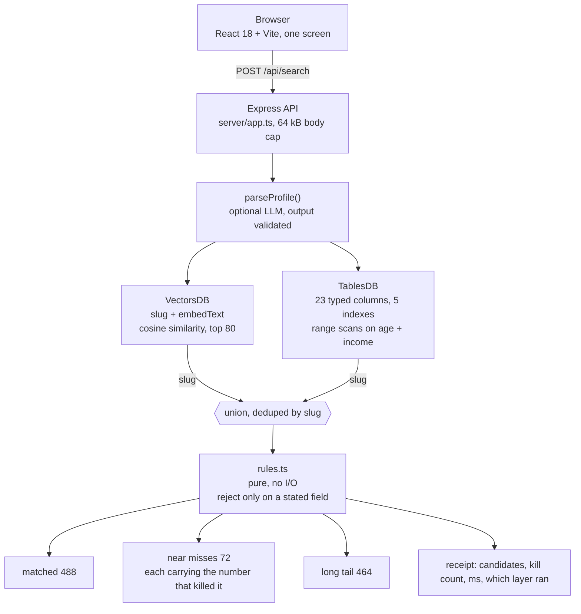
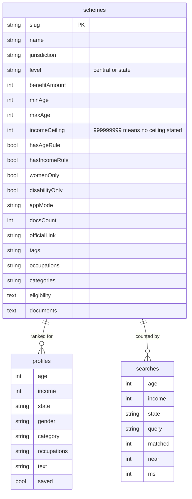

# Eligible

**Describe your life in one sentence. Get the Indian government schemes you actually qualify for, with the reason each one passed and the number that killed the rest.**

```
"I am a 34 year old tailor in Hyderabad, I make about 2.4 lakh a year, two kids in school"
```

→ **488 schemes you qualify for**, 72 close calls, 464 more behind one click, about 95 ms warm, every card carrying its own proof.

Built for the Appwrite Databases Hackathon 2026. Two Appwrite database types, two jobs, one honest answer.

---

## Why two databases

The interesting part of this project is not that it uses Appwrite. It is **why** it uses two different database products for one question.

Eligibility is two questions wearing a trenchcoat:

1. **Does this scheme mean me?** A tailor in Hyderabad is a weaver, an artisan, a small business owner, a parent, and a resident of Telangana. The wording of 2,066 government documents has to be matched against that. That is a meaning problem.
2. **Can this person qualify?** Income ceiling ₹2,50,000. Age 18 to 60. Telangana only. Two documents required. That is arithmetic, and arithmetic wants numbers a query planner can scan.

A vector store answers (1) and cannot answer (2). A table answers (2) and cannot answer (1). So each one does the job it is actually good at, and a slug joins them back together.

| Layer | Appwrite product | Holds | Answers |
|---|---|---|---|
| Meaning | **VectorsDB** | slug + embedded eligibility prose, cosine similarity | "which schemes talk about people like me?" |
| Arithmetic | **TablesDB** | level, state, ministry, age band, income ceiling, rupee benefit, document count | "which of those can I actually get?" |
| Memory | TablesDB | `profiles` and `searches` tables | "what did I ask, what did I save?" |

Both layers feed **one** ranking function. The local fixture path and the Appwrite path call the same `buildResult()`, so a match cannot exist one way and vanish the other.

The data is a public scrape of **myscheme.gov.in**: 527 central schemes, 1,539 state schemes, 80 issuers, 13.4 million characters of eligibility prose. Every row links back to its official page.

---

## Architecture



One request, end to end:

1. The sentence goes in. `parseProfile()` (only if a model key is configured) turns it into `{ age, income, state, gender, category, occupations }`. Every field is validated by the same parser that reads the real CSV, so a hallucinated age cannot get further than a typo can.
2. **VectorsDB** embeds the sentence and returns the top 80 schemes by cosine similarity. These are candidates, never verdicts.
3. **TablesDB** runs its own predicate query on the numeric columns. Cheap, indexed, and it catches schemes the embedding missed.
4. The union is judged by `rules.ts`. A scheme is rejected only on a field it explicitly states. Missing data never denies anybody.
5. Survivors are ranked, rejects become near misses with the exact number that stopped them, and the receipt reports what each layer actually did.

---

## The interface

The first version looked like every other benefits tool: rounded cards on warm paper, which is also exactly what my previous hackathon entry looked like. It was rejected on sight. The rebuild is a different visual argument.

**The entitlement statement.** A cool grey desk, one white sheet on it, hairline rules instead of cards, and a single red seal that is spent only on refusals. Eligibility is a document someone is entitled to, not a marketplace listing, so the page is laid out like a form that has been stamped rather than a feed of products.

| Token | Value | Job |
|---|---|---|
| `--desk` | `#e8eaeb` | the surface behind the sheet, cool not warm |
| `--sheet` | `#ffffff` | the document itself, everything is read on this |
| `--ink` | `#12161a` | body text, 15.9:1 on the sheet |
| `--ink-3` | `#5d6870` | labels and metadata, 6.0:1 |
| `--rule` | `#c2cacf` | the hairline that replaces a card border |
| `--seal` / `--seal-soft` | `#a32a1c` / `#f7e3df` | refusal only, never decoration |
| `--band` / `--band-mute` | `#14181b` / `#a2adb4` | the verdict strip at the top of the answer |
| `--band-refuse` | `#e2644f` | refusal accent on the dark band, 5.2:1 |

**Type does the age-friendly work.** Newsreader (serif) carries statements and amounts; Public Sans carries controls and rows. Both are variable woff2 files served from `public/fonts`, preloaded in `index.html`, no third-party request and no layout shift while the serif loads.

**The result is an instrument, not a list.** The answer opens with a bar drawn to scale: 23.6% of everything read passed, 3.5% was refused, and the legend names all four bands with matching swatches. The 464 remaining matches sit behind one click in a single collapsed panel. Nothing is hidden behind a hover or a gesture, because the person reading this may be doing it on a three year old phone at 9pm.

**Every one of those claims is measured, not asserted.** `npm run audit` drives Chrome at 1440, 1024 and 390 pixels, computes contrast against the real painted background, measures every control, and fails the process if anything regresses:

```
1440px  overflow 0  sub-AA 0  targets<44 0  errors 0  bar 23.6/3.5%  grid 148px 644px 128px
1024px  overflow 0  sub-AA 0  targets<44 0  errors 0  bar 23.6/3.5%  grid 148px 540px 128px
390px   overflow 0  sub-AA 0  targets<44 0  errors 0  bar 23.6/3.5%  grid 318px

PASS: no overflow, no sub-AA text, no small targets, no console errors
```

---

## Stack

| Piece | Choice | Why |
|---|---|---|
| React 18 + TypeScript | UI | one screen, one job, strict types across client and server |
| Vite 5 | build | 160 kB bundle, 51 kB gzipped |
| Express 4 | API | the app must also run on a plain box with no cloud |
| Appwrite VectorsDB + TablesDB | storage | meaning and arithmetic, see above |
| node-appwrite 31 | SDK | real enum names, read out of the installed `.d.ts` files |
| Nomic embeddings | vectors | 1M free tokens covers the corpus twice |
| Newsreader + Public Sans | type | self-hosted variable woff2, 18px root, 52px submit button |
| Playwright | e2e + audit | drives the real UI, then fails the build on contrast, target or overflow regressions |

---

## Run it in five minutes (no Appwrite needed)

The corpus and the fixtures ship in the repo, so the local path runs before anything is configured.

```bash
npm install
npm run build
npm start
```

Open **http://localhost:4317** and type the sentence above. Node 20 or newer.

The server prints the mode it chose:

```
Eligible on http://localhost:4317 · local fixtures
```

That line is the truth. With no credentials it serves the built UI and runs the same engine over the local fixtures. Nothing is mocked: the counts, timings and reasons on screen come from the 2,066 rows.

### Check it without a browser

```bash
curl -s localhost:4317/api/health

curl -s localhost:4317/api/search \
  -H 'content-type: application/json' \
  -d '{"text":"I am a 34 year old tailor in Hyderabad, I make about 2.4 lakh a year, two kids in school"}'
```

Expected: `matched 488`, `near 72`, `union 560`, `killedByRules 72`, about 95 ms once warm (about 350 ms on the first request), and a receipt that says `vectorLayer: "local lexical index (no Appwrite key present)"`. That label matters. Local mode never claims to have searched a vector store.

### Development mode

```bash
npm run api     # API on 4317
npm run dev     # Vite on 5317, proxies /api to 4317
```

Open **http://localhost:5317**. Ports 4317 and 5317 must be free.

### Tests

```bash
npm test        # 21 assertions on extraction, rules and the full pipeline
npm run e2e     # Playwright drives the real UI, screenshots to scratch/shots/
npm run audit   # contrast, tap targets, overflow and the scale bar, at 3 widths
```

`npm run audit` needs the built app running on port 4317 and Chrome installed. It writes `scratch/audit.json` and exits non-zero if any width grows a scrollbar, drops a label under 4.5:1, or shrinks a control under 44 pixels. A design system without a gate is a mood board.

`npm run e2e` needs Google Chrome. It writes `scratch/e2e.json` with the step list, the console error count and the count of interactive targets under 44 pixels. Last run: 7 steps, 0 console errors.

---

## Requirements

- **Node 20 or newer** (built and run on Node 26.12.1, npm 11.20.0)
- About 400 MB of disk for `node_modules`
- No API keys, no database, no network at runtime

---

## Turning on Appwrite

Local mode is not a degraded demo: it is the same rules engine. Appwrite mode moves the two layers into the database, so the work happens in queries instead of in process memory.

**1. Fill in `.env`**

```bash
cp .env.example .env
```

Set three values from your project settings:

```
APPWRITE_ENDPOINT=https://fra.cloud.appwrite.io/v1
APPWRITE_PROJECT_ID=your-project-id
APPWRITE_API_KEY=your-server-key
```

The endpoint carries the region. A Frankfurt project pointed at the Singapore endpoint returns `401 Project is not accessible in this region`, which reads like a bad key and is not.

Scope the key to **rows.read + rows.write**. Create a fresh one for a demo and revoke it afterwards. `.env` is gitignored; nothing in the repo or the build reads it into the browser.

**2. See the plan before touching anything**

```bash
npm run setup:appwrite -- --dry
```

This prints the database, the three tables, every column and index, and the number of rows it would send. No writes.

**3. Create the tables and load the corpus**

```bash
npm run setup:appwrite
```

Creates `eligible` with `schemes` (2,066 rows, 23 columns, 5 indexes), `profiles` and `searches`, sending rows in batches of 100 with a per-row retry so one bad row cannot lose the other ninety-nine.

**4. Check it**

```bash
npm run verify:appwrite
```

Read only. Confirms the project is reachable, that the columns the rules read are present, that the indexes exist (without them every search scans the table), that the row count is complete, and that a vector hit joins back to a real scheme row. Exit code 0 means the table layer is ready.

**5. Restart**

```bash
npm start
```

The banner changes to `· Appwrite` and every receipt in the UI names the tables and vectors it queried.

### The honest cost of the second database

The free plan gives **one database per project** and no dedicated compute. TablesDB on shared compute is free. **VectorsDB needs dedicated compute** (Micro, 1 GB, about **$10/month**) because an HNSW index keeps its graph in RAM.

`scripts/setup-appwrite.ts` tries the vector layer last and, when the project cannot host it, says so and leaves the app fully working: searches then rank by lexical overlap and the UI labels the score `semantic: lexical` instead of claiming a vector search it did not do.

So: one $10/month project for both layers, or the free plan with TablesDB only and lexical recall. There is no configuration in which the app silently pretends.

---

## Data model



The vector collection is deliberately **absent** from this diagram. It holds a slug and an embedding and nothing else, so there is exactly one place where a rupee amount lives.

---

## How a scheme gets judged

The product's credibility rests on one rule: **a scheme is only rejected on a field it actually states.** A missing income ceiling is not a ceiling of zero. That decision lives in `server/rules.ts`:

```ts
// Central schemes apply everywhere, however the row spells it: a table that
// stores `level = central` must not be judged by the string in jurisdiction.
const everywhere =
  scheme.level === 'central' || scheme.jurisdiction === 'All India' || scheme.jurisdiction === 'Central' || !scheme.jurisdiction;

if (!everywhere && profile.state) {
  if (scheme.jurisdiction === profile.state) {
    reasons.push(`${scheme.jurisdiction} scheme`);
    score += 0.2;
  } else {
    blockers.push({
      field: 'state',
      detail: `Only for people in ${scheme.jurisdiction}`,
      gap: `${profile.state} is not ${scheme.jurisdiction}`,
    });
  }
}
```

That comment is a bug report. The first version compared the jurisdiction string only, so a scheme stored as `level: central, jurisdiction: Central` was rejected for a Telangana tailor. The `everywhere` predicate fixed it: `level` decides, not the spelling.

Every blocker carries a `gap` the card can print verbatim, which is why a near miss can say *"Your ₹2.4 lakh is ₹10,000 over the ₹2.4 lakh ceiling"* instead of *"not eligible"*.

Extraction follows the same honesty rule. `parseIncomeCeiling()` records **whether** the document stated a ceiling, not just the value:

```ts
export function parseIncomeCeiling(text: string): { ceiling: number; stated: boolean; clause: string } {
  const parts = sentences(text);
  let best: { ceiling: number; clause: string } | null = null;
  for (const sentence of parts) {
    const low = sentence.toLowerCase();
    if (!low.includes('income')) continue;
    const re = /(?:₹|rs\.?|inr)?\s*(\d[\d,]*(?:\.\d+)?)\s*(crore|cr\b|lakh|lac|lacs|lakhs|thousand|k\b)?/gi;
    let m: RegExpExecArray | null;
    while ((m = re.exec(sentence))) {
      const value = parseRupees(m[0]);
      if (!value) continue;
      if (value < 5000) continue;
      if (value > 50_000_000) continue;
      if (!best || value > best.ceiling) best = { ceiling: value, clause: sentence.trim() };
    }
  }
  if (!best) return { ceiling: NO_INCOME_CEILING, stated: false, clause: '' };
  return { ceiling: best.ceiling, stated: true, clause: best.clause.slice(0, 260) };
}
```

`stated: false` is not a failure. It is the correct answer for the 1,563 schemes that describe no ceiling, and it keeps them eligible for everyone instead of quietly excluding everyone.

---

## The join

VectorsDB returns slugs, TablesDB keys on slugs, and the vector collection stores **only** the slug and the embedding. No rupee amounts, no age bands, no jurisdiction. If it did, there would be two sources of truth for the same fact, and the day they disagreed the app would start lying.

```ts
export async function semanticCandidates(text: string, limit = 80): Promise<Hit[]> {
  const { vectors } = services();
  const [vector] = await embed([text]);
  if (!vector) return [];
  const list = await vectors.listDocuments({
    databaseId: VDB,
    collectionId: V_COLLECTION,
    queries: [Query.vectorCosine('embedding', vector), Query.limit(limit)],
  });
  return (list.documents as unknown as Record<string, unknown>[]).map((doc) => ({
    slug: String(doc.slug ?? doc.$id),
    similarity: readSimilarity(doc),
  }));
}
```

A configured but empty project is the worst looking state there is: a real key, no tables yet, a blank screen. So the search route falls back to the local corpus and says so on the receipt rather than serving nothing.

---

## Proof

| Check | Command | Result |
|---|---|---|
| Engine assertions | `npm test` | 21 passed, 0 failed |
| Types | `npx tsc --noEmit` | clean |
| Bundle | `npm run build` | 160 kB, 51 kB gzipped |
| Browser flow | `npm run e2e` | 7 steps, 0 console errors |
| Interface gate | `npm run audit` | 3 widths, 0 overflow, 0 sub-AA, 0 small targets |
| Storage | `npm run verify:appwrite` | rows + indexes + meaning |

`npm test` runs 21 assertions against the real corpus with no network, no browser and no Appwrite: null columns, central schemes spelled three different ways, an income inside and outside a ceiling, an age below and above a band, a missing ceiling that must not exclude anyone.

The e2e run drives Chrome at 1440 x 960 and asserts the funnel numbers on screen, including the long tail: 464 names inside one collapsed panel, counted after a real click.

---

## Layout

```
index.html            head: font preloads, theme colour, inline SVG favicon
src/                  the UI: one screen, two states (ask, answer)
src/styles.css        the design system: desk, sheet, hairline rules, one seal
public/fonts/         PublicSans-var.woff2 + Newsreader-var.woff2, self-hosted
server/extract.ts     corpus -> typed facts; "no rule stated" beats a guess
server/rules.ts       the decision, and the sentence explaining it
server/engine.ts      recall + decide + rank, shared by both data paths
server/appwrite.ts    the two database layers
server/app.ts         Express: /api/search, /api/meta, /api/health
scripts/ingest.ts     CSV -> fixtures
scripts/setup-appwrite.ts   database, tables, columns, indexes, rows, vectors
scripts/verify-appwrite.ts  read-only proof the cloud side is complete
scripts/test-engine.ts      the rules, asserted
scripts/e2e.mjs             the UI, driven
scripts/audit-ui.mjs        contrast, tap targets, overflow, scale-bar geometry
data/source/schemes.csv     2,066 rows, the corpus
data/fixtures/              pre-built so it runs before ingest (npm run fixtures regenerates)
```

---

## Fork it and contribute

```bash
git clone https://github.com/harishkotra/eligible
cd eligible
npm install
npm run fixtures   # regenerate fixtures from data/source/schemes.csv
npm test           # 21 assertions, no keys needed
npm run dev        # http://localhost:5317
```

**Before you open a PR**

- `npx tsc --noEmit` and `npm test` must be clean. Both run without credentials, so there is no excuse for a red build.
- If you touch extraction, add an assertion to `scripts/test-engine.ts` with the real row that motivated the change. Every bug fixed here started as a failing row.
- If you touch the schema, update `REQUIRED_COLUMNS` in `scripts/verify-appwrite.ts` in the same commit. A schema without a check rots.
- If you touch styles, run `npm run audit`. New colour, new size and new spacing are all fine; a control under 44px or a label under 4.5:1 is not.
- Keep the honesty rules: never deny on missing data, never call lexical recall semantic, never let the model decide eligibility.

### Good first issues

- **Freshness check.** A `scripts/freshness.ts` that diffs `data/source/schemes.csv` against a newer MyScheme export and prints added, changed and removed schemes. One script, no UI, genuinely useful.
- **State coverage report.** Which of the 36 states have thin coverage in the corpus, and which central schemes are the only help available there.
- **Accessibility pass.** Keyboard path through the funnel pills and the long tail panel, with the fix.

### Features worth building

| Idea | Effort | Why it earns its place |
|---|---|---|
| **Ask a follow up** | M | "I have two kids in school" should re-rank, not restart. Keep the profile, re-run only the delta. |
| **Documents checklist export** | S | A printable PDF per scheme. `docsCount` already exists, the list does not. |
| **Saved matches per person** | M | The `profiles` and `searches` tables are provisioned and barely used. A returning user should see what changed since last time. |
| **Deadline awareness** | M | Most schemes run in windows. A `closesOn` column turns a search engine into a calendar. |
| **Explain the near miss better** | S | For every reject, one sentence on what would have to change. The `gap` field already carries the arithmetic. |
| **Local language** | L | Telugu and Hindi first. The hard part is not the UI, it is 2,066 summaries, and that is a transliteration problem more than a translation one. |
| **Coverage map** | M | District level benefit density on a map, to show where the state machinery is thin. |
| **Scheme diffing** | L | Track a scheme's text across corpus snapshots so a silently narrowed ceiling shows up as a change, not a surprise. |

---

## Tradeoffs, stated plainly

- **Ranking is a heuristic, not a model.** Weights on jurisdiction, occupation and category, then the rules verdict. It is inspectable, which matters more here than a learned score nobody can explain.
- **The model never decides eligibility.** It parses a sentence. Its output goes through the same validator as the CSV parser, and the app works with no key and no model at all.
- **VectorsDB is the expensive half.** The $10/month compute is real and this README says so instead of hiding it behind "free tier".
- **2,066 schemes is a snapshot.** It is the whole MyScheme export at build time, and a complete answer needs a refresh pipeline.
- **English only, for now.** Every summary is the government's own wording, cleaned up, not rewritten.

---

## Troubleshooting

**`EADDRINUSE` on 4317**: something else holds the port: `lsof -ti:4317 | xargs kill` or run `PORT=4400 npm start`.

**"No fixtures" or an empty result**: `npm run fixtures` has not run, or `data/source/schemes.csv` is missing from the folder.

**`401 Project is not accessible in this region`**: the region in `APPWRITE_ENDPOINT` does not match the project. Not a bad key. Copy the endpoint from the project settings.

**`Invalid query: Syntax error` from a setup script**: a query was passed as a raw string instead of a `Query.*` object. This SDK version accepts objects only.

**`Invalid document structure: Unknown attribute` on the rows step**: the fixture carries fields the table does not declare (`issuer`, `embedText`, `ageClause`, `genders`). Appwrite rejects the whole payload, so the script projects every row through `toRow()` before sending. If you see it, your copy predates that fix: rebuild from the current archive and rerun, the tables are skipped as they already exist.

**Everything says "local fixtures" after you filled `.env`**: the server started before `.env` existed, or the variable names do not match `.env.example`. Restart it.

**`npm run verify:appwrite` exits 2**: no credentials found; that is local mode, not an error.

**Build fails on `tsc -b`**: check `node -v` is 20 or newer.